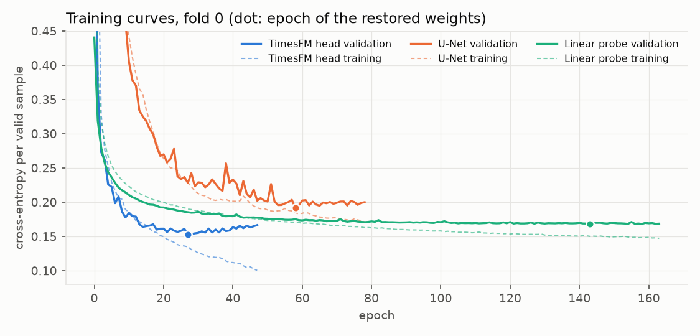
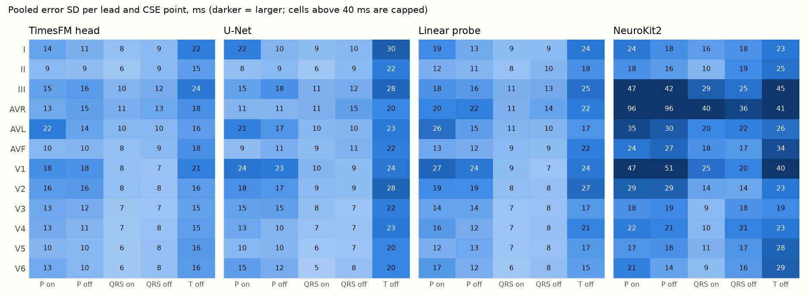
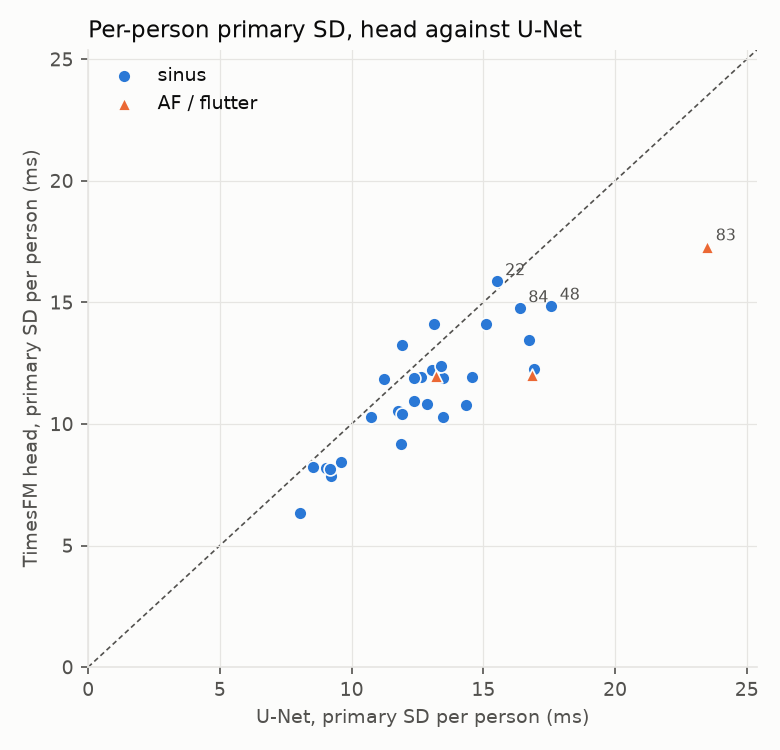
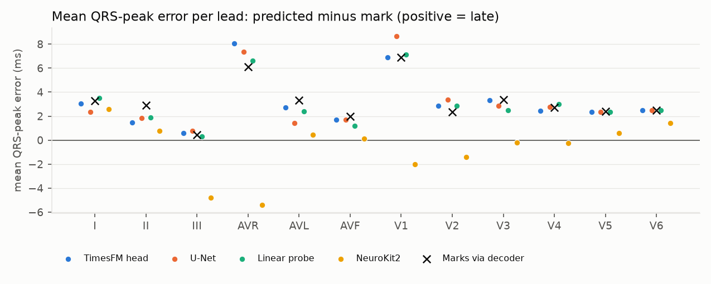
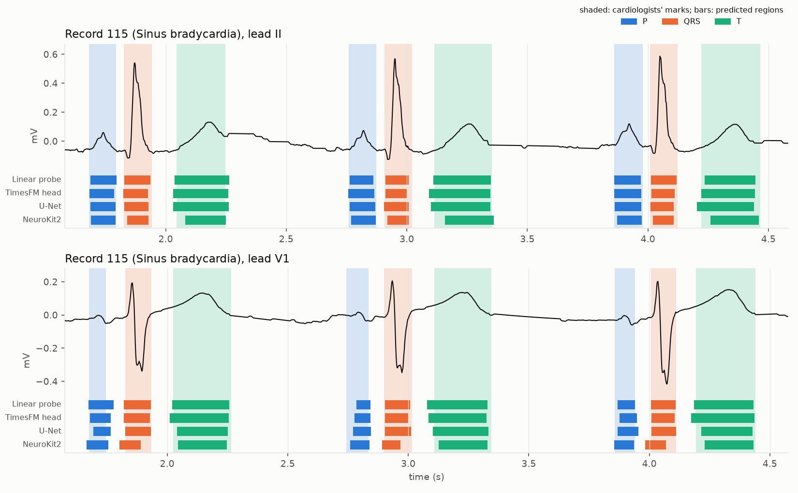
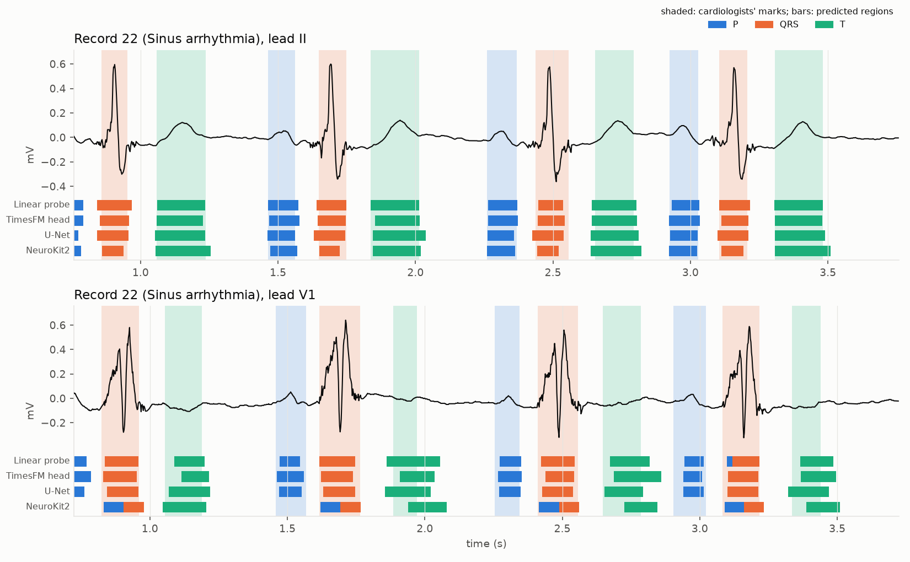
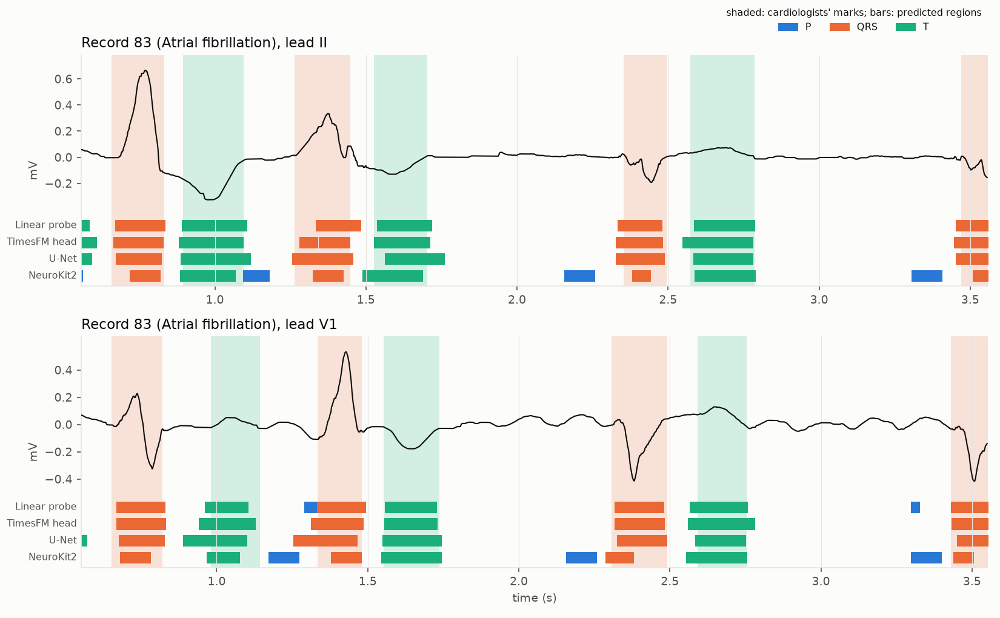
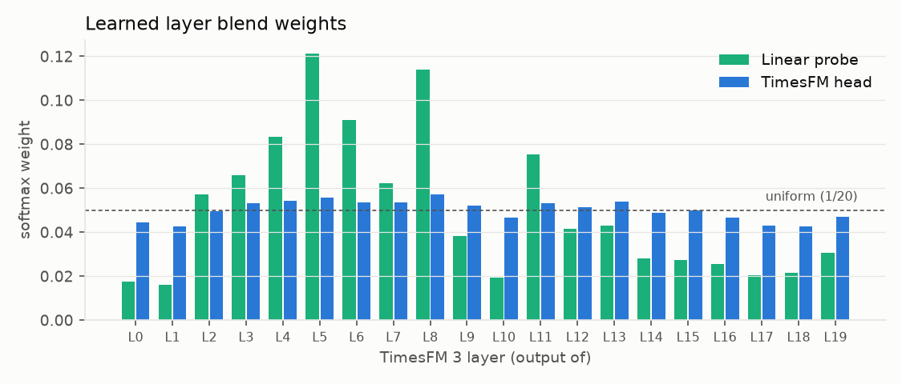

# M3 deep dive: fold 0, validation people only

Generated by `scripts/m3_report.py` from `results/m3/m3_fold0_seed0.json`, the stored predictions, the class maps in `results/m3/m3_fold0_seed0_classes.npz` (from `scripts/m3_classes.py`) and the local LUDB copy. Scope: fold 0 validation people only; development numbers, not results of the study (decisions 54, 59). 32 people, 29 sinus and 3 AF/flutter; the training people are never scored here.

## 1. Headline

| Method | Params | Epochs (best) | Best val loss | Primary SD ms [95% CI] | Mean F1@150 CSE pts % | mIoU | Orphans |
|---|---|---|---|---|---|---|---|
| TimesFM head | 0.49M | 48 (27) | 0.1527 | 12.58 [11.6, 13.5] | 99.2 | 0.855 | 228 |
| U-Net | 1.86M | 79 (58) | 0.1922 | 14.63 [13.4, 15.8] | 99.7 | 0.835 | 714 |
| Linear probe | 0.33M | 164 (143) | 0.1683 | 14.70 [13.2, 16.2] | 99.2 | 0.846 | 405 |
| NeuroKit2 | – | – | – | 30.47 [28.2, 32.7] | 93.6 | 0.633 | 0 |

Primary SD = mean over the five CSE points of the pooled error SD. The exploratory verdicts on these people are in the JSON (`verdicts_validation_only`): head beats U-Net, difference CI [-2.77, -1.33] ms.

## 2. Consistency checks

| Check | Result |
|---|---|
| Local scorer reproduces the JSON primary SD | TimesFM head 12.58 vs 12.58, U-Net 14.63 vs 14.63, Linear probe 14.70 vs 14.70, NeuroKit2 30.47 vs 30.47 |
| Class maps (CPU re-inference) decoded locally give the stored points, leads identical out of 384 | TimesFM head 384, U-Net 384, Linear probe 384 |

The class maps were recomputed on CPU from the saved weights; the stored predictions came from the GPU run. A lead could differ only by an argmax flip at a near-tied sample; the orphan and overlay sections below use the CPU maps.

## 3. Per point

| Point | CSE 2σ | TimesFM head mean / pooled SD / within SD | U-Net mean / pooled SD / within SD | Linear probe mean / pooled SD / within SD | NeuroKit2 mean / pooled SD / within SD |
|---|---|---|---|---|---|
| P on | 10.2 | 1.5 / 14.4 / 8.9 | 0.7 / 16.0 / 8.6 | 2.0 / 18.4 / 10.7 | 6.1 / 38.7 / 14.4 |
| P peak | – | 1.9 / 13.2 / 7.8 | 1.8 / 14.1 / 7.4 | 2.6 / 15.0 / 8.4 | 2.0 / 36.2 / 10.3 |
| P off | 12.7 | -1.7 / 13.0 / 7.6 | -0.9 / 14.5 / 7.1 | 0.6 / 15.7 / 8.9 | 2.0 / 37.2 / 13.1 |
| QRS on | 6.5 | -0.8 / 8.3 / 5.2 | -1.5 / 9.0 / 4.7 | -0.7 / 8.8 / 5.7 | -0.5 / 21.2 / 6.7 |
| QRS peak | – | 3.2 / 13.1 / 3.6 | 3.2 / 12.6 / 3.5 | 3.0 / 13.3 / 4.0 | -0.6 / 13.5 / 2.9 |
| QRS off | 11.6 | 0.3 / 9.3 / 6.3 | -0.2 / 9.8 / 5.2 | 0.2 / 9.5 / 6.7 | -18.7 / 23.9 / 6.7 |
| T on | – | -1.2 / 21.1 / 12.2 | -3.6 / 28.1 / 13.4 | 1.1 / 22.3 / 12.8 | 6.3 / 35.5 / 18.3 |
| T peak | – | 2.1 / 17.3 / 7.7 | 2.2 / 18.3 / 8.6 | 1.4 / 17.5 / 8.3 | 2.6 / 26.1 / 10.2 |
| T off | 30.6 | 0.1 / 17.9 / 10.5 | -0.6 / 23.8 / 11.2 | -1.4 / 21.1 / 11.5 | 12.9 / 31.4 / 16.8 |

| Point | TimesFM head F1@150 / F1@40 % | U-Net F1@150 / F1@40 % | Linear probe F1@150 / F1@40 % | NeuroKit2 F1@150 / F1@40 % |
|---|---|---|---|---|
| P on | 98.5 / 96.3 | 99.4 / 96.2 | 98.4 / 93.8 | 86.5 / 71.2 |
| P peak | 98.5 / 95.7 | 99.4 / 96.2 | 98.4 / 94.4 | 86.3 / 74.1 |
| P off | 98.5 / 97.5 | 99.4 / 97.9 | 98.4 / 95.7 | 86.2 / 72.5 |
| QRS on | 100.0 / 99.9 | 100.0 / 99.8 | 100.0 / 99.7 | 99.1 / 92.8 |
| QRS peak | 99.7 / 97.0 | 99.7 / 96.8 | 99.6 / 96.8 | 99.2 / 96.9 |
| QRS off | 100.0 / 99.9 | 100.0 / 99.9 | 100.0 / 99.9 | 99.1 / 84.2 |
| T on | 99.6 / 94.9 | 99.6 / 87.9 | 99.4 / 93.3 | 96.3 / 81.7 |
| T peak | 99.3 / 95.4 | 99.4 / 95.1 | 99.2 / 95.2 | 96.3 / 89.4 |
| T off | 99.3 / 95.3 | 99.5 / 91.2 | 99.3 / 93.5 | 96.9 / 83.9 |

## 4. Per lead

| Lead | TimesFM head primary SD ms | U-Net primary SD ms | Linear probe primary SD ms | NeuroKit2 primary SD ms |
|---|---|---|---|---|
| I | 12.9 | 16.0 | 14.7 | 19.7 |
| II | 9.7 | 11.1 | 11.5 | 17.7 |
| III | 15.5 | 16.7 | 16.6 | 37.7 |
| AVR | 14.1 | 13.4 | 17.9 | 61.6 |
| AVL | 14.3 | 16.4 | 15.8 | 26.4 |
| AVF | 11.0 | 12.3 | 13.0 | 23.9 |
| V1 | 14.6 | 17.9 | 18.1 | 36.7 |
| V2 | 12.7 | 16.4 | 16.1 | 21.7 |
| V3 | 10.8 | 13.4 | 11.8 | 16.8 |
| V4 | 10.5 | 12.3 | 12.8 | 19.4 |
| V5 | 10.1 | 10.7 | 11.2 | 18.4 |
| V6 | 10.7 | 12.2 | 11.6 | 18.0 |

Largest pooled SD cells among the trained models: U-Net I T off 30 ms; U-Net V2 T off 28 ms; U-Net III T off 28 ms; Linear probe V1 P on 27 ms; Linear probe V2 T off 27 ms; Linear probe AVL P on 26 ms; Linear probe III T off 25 ms; U-Net V1 P on 24 ms.

## 5. Per person

| Record | Rhythm group | TimesFM head | U-Net | Linear probe | NeuroKit2 |
|---|---|---|---|---|---|
| 83 | af_flutter | 17.3 | 23.5 | 17.1 | 36.8 |
| 22 | sinus | 15.9 | 15.5 | 20.6 | 35.4 |
| 48 | sinus | 14.9 | 17.6 | 17.4 | 32.4 |
| 84 | sinus | 14.7 | 16.4 | 15.7 | 28.2 |
| 124 | sinus | 14.1 | 13.1 | 16.8 | 30.6 |
| 76 | sinus | 14.1 | 15.1 | 17.1 | 31.4 |
| 132 | sinus | 13.5 | 16.7 | 17.3 | 27.1 |
| 104 | sinus | 13.3 | 11.9 | 14.0 | 26.3 |
| 4 | sinus | 12.4 | 13.4 | 12.1 | 33.2 |
| 67 | sinus | 12.2 | 16.9 | 16.5 | 32.1 |
| 174 | sinus | 12.2 | 13.1 | 12.8 | 25.5 |
| 112 | af_flutter | 12.0 | 16.8 | 13.8 | 25.5 |
| 173 | af_flutter | 12.0 | 13.2 | 11.9 | 25.4 |
| 20 | sinus | 11.9 | 14.6 | 12.5 | 27.4 |
| 163 | sinus | 11.9 | 12.6 | 13.7 | 25.0 |
| 131 | sinus | 11.9 | 13.5 | 12.0 | 27.7 |
| 169 | sinus | 11.9 | 12.4 | 12.8 | 24.4 |
| 115 | sinus | 11.9 | 11.2 | 11.8 | 25.8 |
| 140 | sinus | 11.0 | 12.3 | 12.4 | 28.8 |
| 11 | sinus | 10.8 | 12.9 | 12.3 | 26.4 |
| 26 | sinus | 10.8 | 14.4 | 13.2 | 25.7 |
| 176 | sinus | 10.5 | 11.8 | 10.7 | 31.6 |
| 36 | sinus | 10.4 | 11.9 | 11.2 | 32.8 |
| 23 | sinus | 10.3 | 13.5 | 11.8 | 29.5 |
| 167 | sinus | 10.3 | 10.7 | 10.7 | 24.6 |
| 16 | sinus | 9.2 | 11.9 | 10.8 | 22.4 |
| 9 | sinus | 8.4 | 9.6 | 8.9 | 18.1 |
| 182 | sinus | 8.2 | 8.6 | 9.3 | 20.3 |
| 123 | sinus | 8.2 | 9.0 | 9.2 | 23.7 |
| 143 | sinus | 8.1 | 9.2 | 8.7 | 23.0 |
| 198 | sinus | 7.9 | 9.2 | 9.0 | 26.3 |
| 144 | sinus | 6.3 | 8.1 | 7.4 | 23.3 |

Per-person primary SD: mean over the CSE points of that person's pooled error SD across leads; points with fewer than two matched pairs are left out, so AF people, who have no P marks, are judged on QRS and T only.

## 6. Orphans

| Model | Edge (outside the marked span) | Extra (slot taken by a nearer wave) | Unanchored (no QRS on the needed side) | Total from class maps | Total in stored predictions |
|---|---|---|---|---|---|
| TimesFM head | 220 | 8 | 0 | 228 | 228 |
| U-Net | 708 | 6 | 0 | 714 | 714 |
| Linear probe | 347 | 58 | 0 | 405 | 405 |

Edge orphans are P or T regions before the lead's first mark or after its last, where no reference exists and nothing is scored. Extra orphans are fragments or doubled waves inside the span. Unanchored orphans inside the span mean a QRS was missed or the P/T sits beyond the last predicted QRS.

## 7. Peaks and the decoder

| Method | P peak mean ± SD ms | QRS peak mean ± SD ms | T peak mean ± SD ms |
|---|---|---|---|
| TimesFM head | 1.9 ± 13.2 | 3.2 ± 13.1 | 2.1 ± 17.3 |
| U-Net | 1.8 ± 14.1 | 3.2 ± 12.6 | 2.2 ± 18.3 |
| Linear probe | 2.6 ± 15.0 | 3.0 ± 13.3 | 1.4 ± 17.5 |
| NeuroKit2 | 2.0 ± 36.2 | -0.6 ± 13.5 | 2.6 ± 26.1 |
| Marks via decoder | 2.1 ± 9.2 | 3.2 ± 11.6 | 1.5 ± 10.3 |

The last row pushes the cardiologists' own regions through the decoder, so it isolates the decoder's peak rule (decision 47) from the models. On these people the rule returns the marked QRS peak exactly for 12.8% of beats and is more than 20 ms away for 3.8%.

Where the extremum of the raw signal lies relative to each mark (largest absolute deflection from the wave's baseline within ±6 samples of the mark):

| Wave | Extremum at the mark | 1 sample after | 2 samples after | Within ±2 samples | Marks |
|---|---|---|---|---|---|
| P | 18.0% | 18.4% | 17.8% | 73.2% | 2613 |
| QRS | 13.3% | 50.4% | 19.9% | 85.7% | 3444 |
| T | 19.2% | 19.9% | 14.3% | 76.3% | 3082 |

Stricter R-wave rules on the round trip (the positive deflection wins only when it reaches a fraction r of the largest absolute deflection; r = 0 is decision 47's rule):

| r | QRS peak mean ms | SD ms | > 20 ms, all leads | > 20 ms, aVR | > 20 ms, V1 |
|---|---|---|---|---|---|
| 0.0 | 3.19 | 11.6 | 3.8% | 20.3% | 6.2% |
| 0.1 | 4.04 | 11.1 | 7.3% | 49.1% | 15.5% |
| 0.3 | 6.34 | 14.0 | 17.3% | 79.4% | 61.7% |
| 1.0 | 10.43 | 17.6 | 34.1% | 87.2% | 87.9% |

## 8. AF and flutter people

| Record | Rhythm | Method | P-onset FP @150 | QRS-onset TP | FN | FP | QRS on SD | QRS off SD | T off SD |
|---|---|---|---|---|---|---|---|---|---|
| 112 | Atrial fibrillation | TimesFM head | 0 | 168 | 0 | 0 | 7.2 | 7.4 | 21.5 |
|  |  | U-Net | 16 | 168 | 0 | 0 | 7.3 | 6.8 | 36.4 |
|  |  | Linear probe | 4 | 168 | 0 | 0 | 6.5 | 7.0 | 28.0 |
|  |  | NeuroKit2 | 159 | 168 | 0 | 4 | 17.8 | 21.1 | 37.7 |
| 83 | Atrial fibrillation | TimesFM head | 8 | 120 | 0 | 1 | 16.1 | 11.2 | 24.6 |
|  |  | U-Net | 0 | 120 | 0 | 0 | 22.1 | 14.8 | 33.6 |
|  |  | Linear probe | 20 | 120 | 0 | 1 | 19.1 | 10.8 | 21.3 |
|  |  | NeuroKit2 | 106 | 116 | 4 | 1 | 34.2 | 39.0 | 37.3 |
| 173 | Atrial fibrillation | TimesFM head | 0 | 144 | 0 | 0 | 9.9 | 8.4 | 17.6 |
|  |  | U-Net | 11 | 144 | 0 | 0 | 11.1 | 9.0 | 19.5 |
|  |  | Linear probe | 0 | 144 | 0 | 0 | 10.2 | 8.4 | 17.1 |
|  |  | NeuroKit2 | 129 | 143 | 1 | 0 | 15.8 | 23.3 | 37.2 |

## 9. Beat overlays

Record 115, median head score among sinus people (head 11.9 ms, U-Net 11.2 ms).

Record 22, worst head score among sinus people (head 15.9 ms, U-Net 15.5 ms).

Record 83, AF/flutter person with the worst head score (head 17.3 ms, U-Net 23.5 ms).

## 10. Layer weights

- Linear probe: max 0.121, min 0.016; heaviest L5 0.121, L8 0.114, L6 0.091, L4 0.084, L11 0.075.
- TimesFM head: max 0.057, min 0.043; heaviest L8 0.057, L5 0.056, L4 0.054, L13 0.054, L7 0.054.

## 11. Findings

1. **The pipeline is consistent.** Re-running the saved weights on CPU and decoding locally reproduces every one of the 384 stored lead predictions for each model (TimesFM head 384, U-Net 384, Linear probe 384), and the local scorer reproduces the JSON's primary SDs to the last digit. Nothing in the result depends on the GPU.

2. **Orphans are edge waves, not fragmentation.** Of the U-Net's 714 orphans, 708 lie before the lead's first mark or after its last, where nothing is scored; the head has 220 such edge waves and the probe 347. Inside the marked span the counts are small (8 head, 6 U-Net, 58 probe fragments or doubled waves) and no orphan is unanchored, so no QRS was missed with a P or T left behind. The U-Net labels the unmarked first and last beats because its convolutions are translation-invariant; the head mostly does not, because the edges are masked in training and the states of the first blocks follow little context. The probe's fragments are what one block at a time costs; the head's convolutions remove nearly all of them. **No action.**

3. **The QRS-peak bias belongs to the decoder and comes from LUDB's marks.** Pushing the cardiologists' own regions through the decoder gives a mean QRS-peak error of +3.2 ms, the same as the three models. The reason is in the marks: the extremum of the raw signal lies one sample after the QRS mark for 50% of beats and two samples after for 20%, at the mark for only 13%. LUDB's peak marks sit about one sample (2 ms) before the signal's extremum, systematically. The models learn and are scored against the marks, so this touches nothing in the primary metric, which uses onsets and offsets only; it shifts the reported QRS, P and T peak means by about +2 ms. **Proposed, for your decision:** either (a) leave the decoder as it is and state the offset in the paper, or (b) move every decoder peak one sample earlier before the freeze, logged as a development-stage decision like decision 47. I recommend (a): the correction would be tailoring to an annotation convention, and the mean error is reported anyway.

4. **The larger QRS-peak disagreements are morphology, mostly in aVR.** With decision 47's rule, 3.8% of round-trip QRS peaks are more than 20 ms from the mark, 20% in aVR and 6% in V1. Every stricter rule tested is worse (at r = 0.1 already 7.3% overall and 49% in aVR), so the cardiologists do mark small r waves and decision 47 stands. **No action.**

5. **P and T peaks have a decoder floor too.** The round trip reproduces the marked P peak with an SD of 9 ms and the T peak with 10 ms: for broad waves the marked peak is not the extremum of the high-passed signal to within a few samples. The models' P-peak and T-peak SDs (13 and 17 ms for the head) include that floor. The alternatives tested, the extremum about the region mean and the raw extremum, are far worse (P 37 to 40 ms). **No action.**

6. **Per lead, T offset is the hardest point everywhere** (mean over leads: head 18 ms, U-Net 23 ms, probe 21 ms), and it is where the head gains most on the U-Net, followed by P onset and offset in V1 and V2. QRS onset and offset are 6 to 13 ms for all trained models in every lead. NeuroKit2's weak leads are aVR, III and V1, where its P detections are far off.

7. **Per person, the head is at or below the U-Net for 28 of 32 people and at or below the probe for 28.** The worst person for every method is record 83 (atrial fibrillation). On the 3 AF/flutter people all methods emit P-wave false positives (P-onset FPs at 150 ms: TimesFM head 8, U-Net 27, Linear probe 24, NeuroKit2 394); the models saw only 11 AF/flutter people among the 128 training people, and nothing tells them that a P-shaped bump during fibrillation is not a P wave. This is expected and is reported by rhythm. **No action.**

8. **Layer weights.** The probe concentrates on layers L5, L8, L6, L4, L11 (weights 0.121 down to 0.075) and nearly switches off L0, L1 and L14 to L19 (0.016 to 0.03); the head stays between 0.043 and 0.057, close to uniform. A linear probe can only select layers; the head's 2560 to 128 projection selects features inside every layer and needs no layer selection. The per-layer probes, now a possible later step, would show the picture directly. **No action for M4.**

9. **Training.** The head's validation loss bottoms at epoch 27 and then rises while the training loss keeps falling: it overfits 128 recordings quickly, and early stopping handles it. The U-Net's validation loss is noisy and still drifts down when patience stops it at epoch 78 (best 58); the probe is slow, best at epoch 143 of 164. Decision 62 keeps the recipe. For M4's cost the probe matters most: a fold container runs until its slowest model stops, and the probes will be the slowest.

**Summary for the freeze:** the labels, the decoder and the scorer behave as designed; the only decision open is item 3, and the recommendation is to leave the decoder unchanged.
