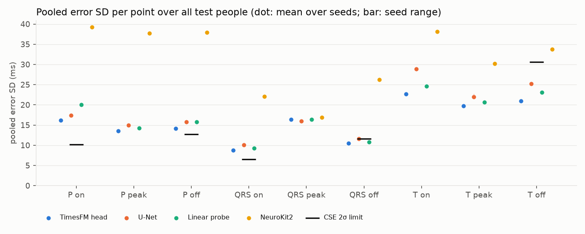
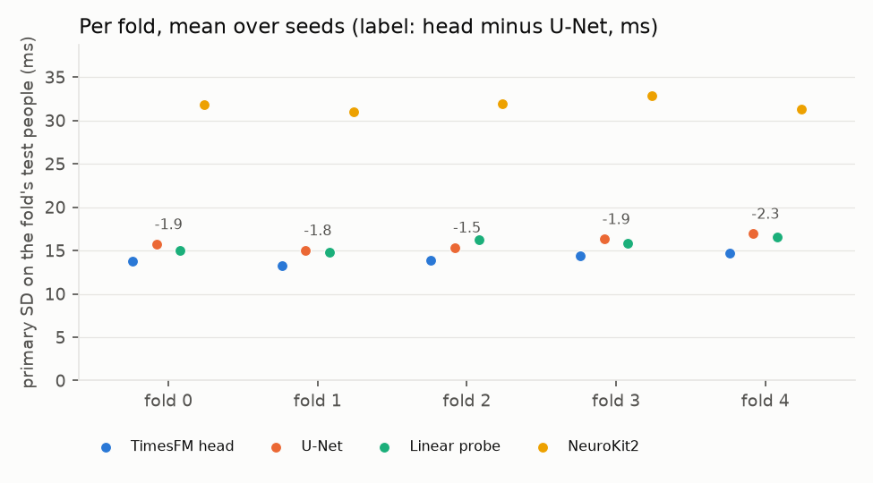

# Step 1 results: TimesFM 3 states against a U-Net and NeuroKit2 on LUDB

Generated by `scripts/final_report.py` on 2026-10-11 from runs m4_fold0, m4_fold1, m4_fold2, m4_fold3, m4_fold4 (git step1-frozen; states revision 43046b85; splits `splits/ludb_5fold_seed0.json`). 200 test people from 5 folds, each predicted by models that never saw them; seeds [0, 1, 2]. Primary metric: mean over the five CSE points of the pooled error SD, computed per seed and averaged over seeds inside every bootstrap draw (decision 64).

## 1. Stop-rule verdict

**TimesFM helps: the main head beats the U-Net.**

| Test | Value | Rule |
|---|---|---|
| Head minus U-Net, primary SD, 95% paired bootstrap interval | [-2.28, -1.53] ms | entirely below zero |
| Head minus U-Net, mean F1 at 150 ms over the CSE points, 95% interval | [-0.0009, +0.0086] | not entirely below zero |
| Per-fold head minus U-Net (information only) | -1.93, -1.79, -1.48, -1.91, -2.27 ms | – |

## 2. Headline

| Method | Params | Primary SD ms [95% CI] | Per seed | Mean F1@150, CSE points % | mIoU | Sinus | AF/flutter |
|---|---|---|---|---|---|---|---|
| TimesFM head | 0.49M | 14.11 [13.38, 14.86] | 14.14, 14.10, 14.10 | 98.83 | 0.841 | 13.58 | 19.02 |
| U-Net | 1.86M | 16.01 [15.17, 16.81] | 16.16, 15.85, 16.03 | 98.47 | 0.813 | 15.22 | 23.53 |
| Linear probe | 0.33M | 15.80 [14.93, 16.67] | 15.79, 15.81, 15.82 | 98.40 | 0.825 | 15.26 | 20.01 |
| NeuroKit2 | – | 31.84 [30.82, 32.85] | – | 93.67 | 0.621 | 31.16 | 34.22 |

Sinus and AF/flutter columns: the primary SD within each rhythm group, averaged over seeds; AF people have no P marks, so their P points carry no error SD and the group's primary is over QRS onset, QRS offset and T offset only.

## 3. Per point (mean over seeds)

| Point | CSE 2σ | TimesFM head mean / pooled SD / within SD | U-Net mean / pooled SD / within SD | Linear probe mean / pooled SD / within SD | NeuroKit2 mean / pooled SD / within SD |
|---|---|---|---|---|---|
| P on | 10.2 | 0.8 / 16.2 / 9.4 | 0.0 / 17.4 / 9.3 | 2.5 / 20.0 / 10.8 | 4.0 / 39.2 / 15.9 |
| P peak | – | 1.6 / 13.5 / 7.6 | 1.3 / 14.9 / 7.8 | 2.1 / 14.2 / 8.1 | 1.6 / 37.7 / 11.6 |
| P off | 12.7 | -0.6 / 14.2 / 8.4 | -0.2 / 15.8 / 7.8 | -1.0 / 15.8 / 9.3 | 1.8 / 37.9 / 14.6 |
| QRS on | 6.5 | -0.1 / 8.7 / 5.5 | -0.4 / 10.1 / 5.0 | -0.0 / 9.3 / 6.0 | -1.1 / 22.1 / 7.9 |
| QRS peak | – | 4.2 / 16.4 / 4.1 | 4.1 / 15.9 / 4.0 | 4.1 / 16.3 / 4.4 | -0.8 / 16.9 / 3.8 |
| QRS off | 11.6 | 0.8 / 10.5 / 6.5 | 0.5 / 11.6 / 5.6 | -0.1 / 10.8 / 6.8 | -19.3 / 26.2 / 7.5 |
| T on | – | 0.7 / 22.7 / 13.1 | -0.8 / 28.9 / 14.4 | 2.2 / 24.7 / 14.4 | 4.1 / 38.1 / 18.6 |
| T peak | – | 1.0 / 19.8 / 9.0 | 0.9 / 22.0 / 10.1 | 0.2 / 20.6 / 9.7 | 0.8 / 30.2 / 11.1 |
| T off | 30.6 | -1.1 / 20.9 / 11.1 | -0.2 / 25.2 / 12.1 | -3.4 / 23.1 / 12.2 | 10.2 / 33.7 / 17.0 |

| Point | TimesFM head F1@150 / F1@40 % | U-Net F1@150 / F1@40 % | Linear probe F1@150 / F1@40 % | NeuroKit2 F1@150 / F1@40 % |
|---|---|---|---|---|
| P on | 97.58 / 94.84 | 96.67 / 93.05 | 96.92 / 91.81 | 87.63 / 73.00 |
| P peak | 97.60 / 94.77 | 96.69 / 92.97 | 96.97 / 93.69 | 87.71 / 74.22 |
| P off | 97.60 / 95.99 | 96.69 / 94.14 | 97.00 / 94.65 | 87.57 / 73.73 |
| QRS on | 99.90 / 99.65 | 99.81 / 99.16 | 99.73 / 99.36 | 98.48 / 91.51 |
| QRS peak | 99.59 / 95.41 | 99.42 / 95.15 | 99.51 / 95.41 | 98.63 / 94.90 |
| QRS off | 99.90 / 99.50 | 99.81 / 99.00 | 99.73 / 99.03 | 98.46 / 82.14 |
| T on | 99.49 / 93.51 | 99.60 / 86.62 | 98.85 / 91.11 | 95.90 / 79.58 |
| T peak | 99.22 / 94.51 | 99.31 / 93.67 | 98.65 / 93.32 | 96.03 / 87.27 |
| T off | 99.17 / 93.86 | 99.35 / 90.28 | 98.63 / 91.50 | 96.21 / 81.67 |

## 4. Other comparisons

| Pair (a vs b) | a minus b, primary SD 95% CI ms | a minus b, F1@150 95% CI | a better | F1 safeguard | a wins |
|---|---|---|---|---|---|
| TimesFM head vs U-Net | [-2.28, -1.53] | [-0.0009, +0.0086] | yes | yes | yes |
| TimesFM head vs NeuroKit2 | [-18.46, -17.01] | [+0.0410, +0.0633] | yes | yes | yes |
| U-Net vs NeuroKit2 | [-16.57, -15.11] | [+0.0364, +0.0605] | yes | yes | yes |
| Linear probe vs NeuroKit2 | [-16.72, -15.37] | [+0.0373, +0.0585] | yes | yes | yes |
| TimesFM head vs Linear probe | [-2.00, -1.38] | [+0.0024, +0.0064] | yes | yes | yes |

## 5. Per fold (information only)

| Fold | Test people | TimesFM head | U-Net | Linear probe | NeuroKit2 | Head minus U-Net |
|---|---|---|---|---|---|---|
| fold 0 | 40 | 13.81 | 15.74 | 15.02 | 31.83 | -1.93 |
| fold 1 | 40 | 13.25 | 15.04 | 14.79 | 31.03 | -1.79 |
| fold 2 | 40 | 13.88 | 15.36 | 16.21 | 31.89 | -1.48 |
| fold 3 | 40 | 14.43 | 16.34 | 15.85 | 32.84 | -1.91 |
| fold 4 | 40 | 14.68 | 16.95 | 16.57 | 31.27 | -2.27 |

## 6. Training

| Fold | Model | Epochs (best) | Best val loss | Model minutes | Fold test primary SD ms |
|---|---|---|---|---|---|
| fold 0 | probe_s0 | 164 (143) | 0.1683 | 42.6 | 15.02 |
| fold 0 | head_s0 | 48 (27) | 0.1532 | 4.1 | 13.89 |
| fold 0 | unet_s0 | 118 (97) | 0.1908 | 0.9 | 16.03 |
| fold 0 | probe_s1 | 164 (143) | 0.1683 | 13.8 | 15.07 |
| fold 0 | head_s1 | 51 (30) | 0.1494 | 4.4 | 13.81 |
| fold 0 | unet_s1 | 178 (157) | 0.1882 | 1.3 | 15.46 |
| fold 0 | probe_s2 | 187 (166) | 0.1680 | 19.8 | 14.98 |
| fold 0 | head_s2 | 51 (30) | 0.1512 | 4.4 | 13.72 |
| fold 0 | unet_s2 | 80 (59) | 0.1928 | 0.6 | 15.73 |
| fold 0 | container |  |  | load 33 s, train 109 min, test 17 s | GPU 4.7 GiB, Tesla T4 |
| fold 1 | probe_s0 | 172 (151) | 0.1845 | 40.4 | 14.81 |
| fold 1 | head_s0 | 47 (26) | 0.1666 | 3.8 | 13.41 |
| fold 1 | unet_s0 | 150 (129) | 0.1870 | 1.1 | 14.63 |
| fold 1 | probe_s1 | 172 (151) | 0.1844 | 13.7 | 14.77 |
| fold 1 | head_s1 | 47 (26) | 0.1651 | 3.8 | 13.03 |
| fold 1 | unet_s1 | 100 (79) | 0.1923 | 0.7 | 15.24 |
| fold 1 | probe_s2 | 172 (151) | 0.1844 | 13.7 | 14.80 |
| fold 1 | head_s2 | 47 (26) | 0.1627 | 3.8 | 13.29 |
| fold 1 | unet_s2 | 130 (109) | 0.1892 | 1.0 | 15.24 |
| fold 1 | container |  |  | load 34 s, train 92 min, test 17 s | GPU 4.7 GiB, Tesla T4 |
| fold 2 | probe_s0 | 143 (122) | 0.1917 | 34.0 | 16.19 |
| fold 2 | head_s0 | 47 (26) | 0.1792 | 3.8 | 13.92 |
| fold 2 | unet_s0 | 95 (74) | 0.2159 | 0.7 | 16.16 |
| fold 2 | probe_s1 | 143 (122) | 0.1917 | 11.4 | 16.17 |
| fold 2 | head_s1 | 54 (33) | 0.1795 | 4.4 | 13.78 |
| fold 2 | unet_s1 | 114 (93) | 0.2121 | 0.9 | 14.58 |
| fold 2 | probe_s2 | 143 (122) | 0.1917 | 11.4 | 16.27 |
| fold 2 | head_s2 | 48 (27) | 0.1771 | 3.9 | 13.96 |
| fold 2 | unet_s2 | 96 (75) | 0.2165 | 0.7 | 15.35 |
| fold 2 | container |  |  | load 35 s, train 81 min, test 17 s | GPU 4.7 GiB, Tesla T4 |
| fold 3 | probe_s0 | 141 (120) | 0.1919 | 33.7 | 15.81 |
| fold 3 | head_s0 | 47 (26) | 0.1710 | 3.8 | 14.47 |
| fold 3 | unet_s0 | 112 (91) | 0.2186 | 0.9 | 16.14 |
| fold 3 | probe_s1 | 141 (120) | 0.1919 | 11.3 | 15.90 |
| fold 3 | head_s1 | 50 (29) | 0.1688 | 4.1 | 14.41 |
| fold 3 | unet_s1 | 93 (72) | 0.2197 | 0.7 | 16.46 |
| fold 3 | probe_s2 | 106 (85) | 0.1931 | 8.5 | 15.86 |
| fold 3 | head_s2 | 47 (26) | 0.1683 | 3.8 | 14.41 |
| fold 3 | unet_s2 | 89 (68) | 0.2168 | 0.7 | 16.42 |
| fold 3 | container |  |  | load 36 s, train 76 min, test 18 s | GPU 4.7 GiB, Tesla T4 |
| fold 4 | probe_s0 | 140 (119) | 0.1667 | 33.4 | 16.54 |
| fold 4 | head_s0 | 58 (37) | 0.1505 | 4.7 | 14.51 |
| fold 4 | unet_s0 | 65 (44) | 0.2001 | 0.5 | 17.14 |
| fold 4 | probe_s1 | 140 (119) | 0.1667 | 11.2 | 16.59 |
| fold 4 | head_s1 | 58 (37) | 0.1489 | 4.7 | 14.87 |
| fold 4 | unet_s1 | 73 (52) | 0.1958 | 0.5 | 16.97 |
| fold 4 | probe_s2 | 140 (119) | 0.1666 | 11.2 | 16.58 |
| fold 4 | head_s2 | 52 (31) | 0.1495 | 4.2 | 14.66 |
| fold 4 | unet_s2 | 96 (75) | 0.1710 | 0.7 | 16.74 |
| fold 4 | container |  |  | load 33 s, train 80 min, test 18 s | GPU 4.7 GiB, Tesla T4 |

All models: AdamW, learning rate 1e-3, weight decay 1e-4, batch 8, up to 200 epochs, patience 20 on the validation loss, best weights restored; one data stream per fold shared by all seeds and models (decisions 31 and 58).
